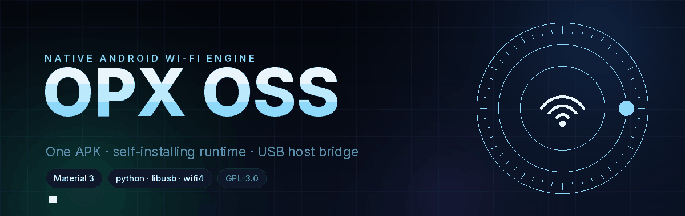
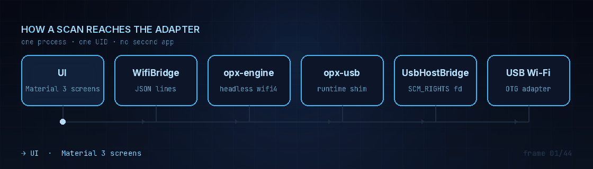
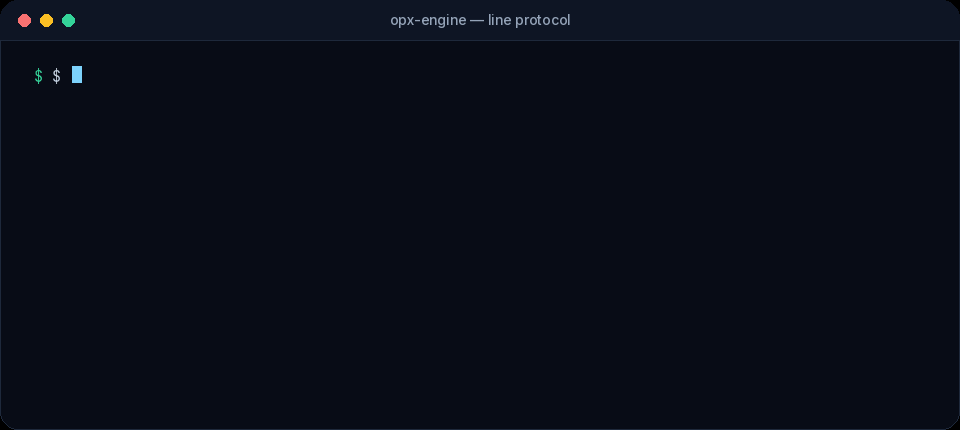
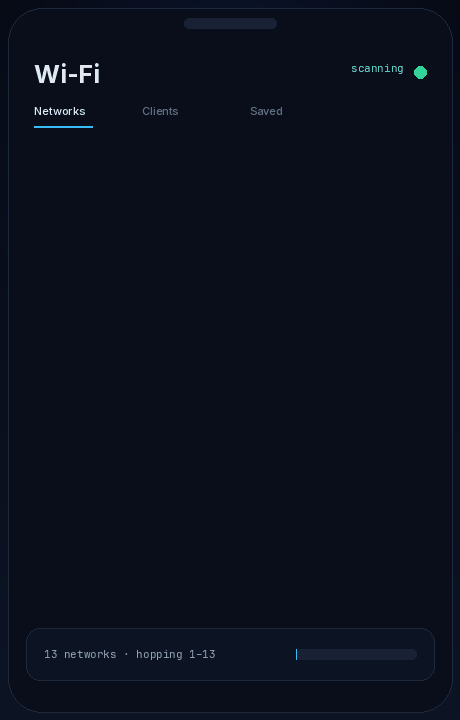

<div align="center">
  
</div>

<div align="center">

# OPX OSS

**The wireless engine, its USB host bridge and a guided interface — one APK, no terminal, no companion app.**

[](https://github.com/OPX-official/opx-oss/actions/workflows/build.yml)
[](https://github.com/OPX-official/opx-oss/actions/workflows/packages.yml)
[](https://github.com/OPX-official/opx-oss/releases/tag/latest)
[](app/build.gradle)
[](app/build.gradle)
[](tools/build-base.sh)
[](https://github.com/OPX-official/opx-wifi4)
[](LICENSE)

<sub>Use only on networks and devices you own or are explicitly authorized to test.</sub>

</div>

---

## Contents

| | |
|---|---|
| [Overview](#overview) | what this project is, and what it deliberately is not |
| [At a glance](#at-a-glance) | the facts a reviewer checks first |
| [Architecture](#architecture) | how a scan reaches the adapter |
| [The engine](#the-engine) | the headless line protocol behind every screen |
| [The USB bridge](#the-usb-bridge) | the app's own USB host API |
| [Cracking](#cracking) | built-in CPU cracker, optional GPU path |
| [The interface](#the-interface) | screens, states and diagnostics |
| [Package archive](#package-archive) | where binaries come from, and how they are audited |
| [Build from source](#build-from-source) | APK and packages, locally |
| [Continuous delivery](#continuous-delivery) | the two workflows and what they publish |
| [Install](#install) | first launch, step by step |
| [Project layout](#project-layout) | where everything lives |
| [Roadmap](#roadmap) | shipped and planned |
| [Credits & license](#credits--license) | upstream work and legal terms |

---

## Overview

Most Android wireless toolkits are a terminal emulator plus a collection of scripts, or a shell app
that needs a second app installed and signed with the same key. OPX OSS takes the native route:
**one APK owns its own runtime**, compiled for its own private prefix, and the wireless engine runs
as a headless service inside the app process boundary.

```
com.opx.oss
└── /data/data/com.opx.oss/files/usr      ← the runtime prefix, owned by this app
    ├── bin/         bash · python3 · apt · opx-engine · opx-usb
    ├── lib/         libusb · OpenCL loader
    └── var/opx/     captures · credentials
```

Nothing is shared with another app, nothing is downloaded at build time into the APK, and there is
**no terminal section, no terminal shortcut and no companion app**. On first launch the app fetches
a verified runtime from its own package archive, checks every SHA-256, resumes interrupted
downloads, and unpacks it into the prefix above.

The engine itself is [wifi4](https://github.com/OPX-official/opx-wifi4) — shipped as a **library**, with its desktop UI,
privileged setup modules and console entry point removed at package time. `tools/engine/opx_engine.py`
exposes that library as a JSON line protocol, so the interface never parses human output.

---

## At a glance

| | |
|---|---|
| **Package** | `com.opx.oss` |
| **Version** | `0.3.0-alpha.1` (`versionCode` derived from the CI run number) |
| **Platform** | Android 6.0+ (`minSdk 23`), `targetSdk 28` on purpose — see [why](#targetsdk-28) |
| **Architectures** | `arm` (32-bit) and `aarch64` (64-bit) runtimes |
| **Runtime** | python 3.14 · libusb 1.0 · bash · coreutils · apt, installed into the app's prefix |
| **Engine** | wifi4 0.7.1, headless, driven over stdin/stdout with one JSON object per line |
| **USB access** | in-process host bridge over the abstract socket `opx.usb`, descriptors passed with `SCM_RIGHTS` |
| **Cracking** | built-in CPU cracker (always) · Hashcat when the runtime ships it (optional) |
| **Licence** | GPL-3.0 |

### `targetSdk 28`

Android 10+ refuses `execve()` on files inside an app's home directory for apps targeting API 29
or newer — and the entire runtime lives in `<files>/usr`. Targeting 28 is what keeps the app able
to start its own binaries without a virtualisation layer. The trade-off is documented here instead
of being hidden in a gradle comment.

---

## Architecture

<div align="center">
  
</div>

```
┌──────────────────────────── OPX OSS (com.opx.oss, one UID) ─────────────────────────────┐
│                                                                                         │
│  Material 3 UI ── WiFi · Handshakes · Saved passwords · Logs · Home · About             │
│        │                                                                                │
│        ▼                                                                                │
│  WifiBridge ──── one JSON command per line, every line mirrored into the in-app log     │
│        │                                                                                │
│  OpxService ──── foreground host: installs the runtime, keeps the engine alive          │
│        │                                                                                │
│  opx-engine (python) ── wifi4 as a library, no TUI, one event per line                  │
│        │                                                                                │
│  opx-usb (runtime shim) ── asks the app for a descriptor                                │
│        │                                                                                │
│  UsbHostBridge ── abstract socket "opx.usb" → UsbManager → fd → SCM_RIGHTS              │
│        │                                                                                │
│  native runtime under /data/data/com.opx.oss/files/usr: python · libusb · bash · wifi4  │
└───────────────────────────────────────┬─────────────────────────────────────────────────┘
                                        │ Android USB host API
                                OTG USB Wi-Fi adapter
```

Three invariants hold the design together:

1. **One process, one UID.** The engine is a child of the app. There is no second APK to install,
   no API app to sign with the same key, and no service that can be spoofed from another UID — the
   bridge rejects requests whose peer UID is not the app's own.
2. **Every binary is compiled for this prefix.** The base runtime is built from source with the
   build system's app identity forked to `com.opx.oss` (`tools/patch-properties.py`). Artifacts are
   audited for a foreign prefix and the build fails if one is found.
3. **No virtualisation.** There is no `proot`, no fake rootfs, and no mixing of packages compiled
   for someone else's prefix. A native app's runtime belongs in its own directory, and that is
   where this one lives.

### Why the USB layer is part of the app

`wifi4` asks an external command for its adapter descriptor. Upstream, that command belongs to a
second app. OPX OSS ships the command itself — `opx-usb`, a native script inside its own runtime —
and answers it from Java:

```
wifi4 → opx-usb → abstract socket "opx.usb" → UsbHostBridge → UsbManager → SCM_RIGHTS fd → libusb
```

The adapter is never opened by anyone else, the permission dialog belongs to this app, and the
descriptor is duplicated before it is handed over so both sides close independently.

---

## The engine

<div align="center">
  
</div>

The app never screenscrapes. Each command is one line of JSON on stdin; each event is one line of
JSON on stdout, and stderr is mirrored into the same log the Logs screen shows.

| Command | Result |
|---|---|
| `{"cmd":"ping"}` | `ready` — version, prefix, python, engine and USB backend state |
| `{"cmd":"devices"}` | `devices` — attached adapters, with the USB reason when the list is empty |
| `{"cmd":"status"}` | `status` — interface, band, access-point count |
| `{"cmd":"scan","seconds":25}` | `network` … then `scan_done` |
| `{"cmd":"targets"}` | `targets` — every AP with the attacks the engine can actually run |
| `{"cmd":"attack","kind":"…","bssid":"…"}` | `attack_started` → `attack_log` / `attack_progress` → `attack_done` |
| `{"cmd":"deauth_client"}` · `deauth_all` · `silence` | one-shot actions, each with its own event |
| `{"cmd":"captures"}` | `captures` — the capture vault and its saved credentials |
| `{"cmd":"crack_tools"}` | `crack_tools` — which cracking backends this runtime can start |
| `{"cmd":"crack","capture":"…","tool":"cpu_crack\|hashcat"}` | `crack_started` → `crack_progress` → `crack_done` |
| `{"cmd":"stop"}` · `stop_attack` · `stop_crack` | a clean stop, never a killed process |

Two details worth knowing:

* **Eligibility is the engine's, not the UI's.** Attack buttons come from the campaign classes'
  own `visible()` / `ineligible_reason()`, so a button the radio cannot run is never offered as if
  it could.
* **Failures carry a traceback.** A scan that dies inside wifi4 reports the exception *and* the
  full traceback in the same event, which is why the Logs screen is enough to debug a device
  without a cable.

---

## The USB bridge

* The bridge listens on the abstract socket `opx.usb` for the lifetime of the engine.
* `{"cmd":"list"}` returns the adapters Android exposes to this app, filtered to the chipsets the
  engine's catalogue knows (ZeroCD stubs included), so unrelated USB hardware never triggers a
  permission dialog.
* `{"cmd":"open","path":"…"}` asks Android for permission if needed, opens the device, duplicates
  the descriptor and sends it over `SCM_RIGHTS` in the same reply.
* Detach, permission answers, restart and socket reuse are all handled: a stopped engine releases
  the socket so the next start binds cleanly, and the app refuses to run the engine blind when the
  bridge is not listening.

Supported adapters are the engine's own catalogue, kept current by wifi4: Atheros **AR9271**;
MediaTek **MT7601 / MT76x0 / MT76x2 / MT7921 / MT7925**; Ralink **RT2500 / RT3070 / RT3572 / RT5370 /
RT5372 / RT5572**; Realtek **RTL8187 / 8188 / 8192 / 8812 / 8814 / 8821 / 8822 / 8922** families.

---

## Cracking

Captures land in `$PREFIX/var/opx/captures` as `.hc22000` files and show up in **Handshakes** with
their SSID, BSSID and type.

| Path | Availability | Notes |
|---|---|---|
| **CPU Crack** | always | pure python, no external binary; built-in 2 300-entry default list, SSID-derived candidates, SSIDs probed nearby, and your own wordlists |
| **Hashcat (GPU)** | optional | offered only when the runtime actually ships the binary; the card states the exact reason when it does not |

The dialog reports progress, allows a clean stop, and shows the recovered key with a copy button.
The GPU path also prepares the vendor OpenCL library at startup, so a device with a working driver
gets a real accelerator instead of a silently missing one.

---

## The interface

<div align="center">
  
</div>

| Screen | What it does |
|---|---|
| **Home** | runtime state, quick access to WiFi, Handshakes and Logs |
| **WiFi** | live scan list, per-AP target sheet, attack controls, USB state and a copyable USB diagnosis |
| **Handshakes** | the capture vault: crack, review results, copy a key |
| **Saved passwords** | every credential the engine recovered or verified |
| **Logs** | every engine, USB and service line, with *Copy all* |
| **Settings** | DFS channel hopping, storage links, runtime details, log controls |
| **About** | build, runtime and licence information |

Design language: Material 3, one accent, dark-first, motion only where it carries meaning —
the attack monitor's sparkline is a live packet-rate window, not decoration.

---

## Package archive

Binaries never come from another app's releases and are never baked into the APK. They come from
the project's own archive, [`OPX-official/opx-packages`](https://github.com/OPX-official/opx-packages):

| Path | Contents |
|---|---|
| `index.json` | catalogue: name, version, architecture, size, SHA-256 and exact URL of every artifact |
| `pool/main/…/*.deb` | apt-compatible packages |
| `dists/stable/main/binary-<arch>/Packages.gz` | apt index |
| `payload/<arch>/…tar.gz` | runtime trees, ready to unpack into the prefix |
| `payload/all/…tar.gz` | architecture-independent packages: engine, wifi4, USB shim |
| `base/bootstrap/bootstrap-<arch>.zip` | the bootstrap built for `com.opx.oss` (release asset) |

Git branches reject files over 100 MiB, so the bootstrap archives live as assets of the
`packages` release; `index.json` carries their URLs, which is why a consumer never needs to know
where a given artifact is stored.

### Build gates

Every artifact passes the same audit before it is published:

| Gate | What it refuses |
|---|---|
| `tools/patch-properties.py` | a build where the app identity is not `com.opx.oss` |
| `tools/prune-foreign.py` | any file that names another app's package |
| `tools/prune-size.py` | build-only weight: headers, static archives, man pages, python's own tests |
| `tools/rebrand-runtime.py` | upstream banners, mirror lists and app-store pointers in the shipped tree |
| `tools/make-index.py` | a catalogue that does not match the bytes it publishes |

---

## Build from source

**APK** (small by design — the runtime is downloaded on first launch):

```bash
./gradlew assembleDebug
# app/build/outputs/apk/debug/app-debug.apk
```

**Packages** (needs a wifi4 checkout and the package build system's docker builder):

```bash
WIFI4_SRC=../opx-wifi4 bash tools/build-packages.sh     # scope=all
# out/ holds the payloads, bootstrap archives and index.json
```

Requirements: JDK 17, Android SDK 36 for the app; docker, python 3 and the pinned package
toolchain for the runtime. Signing is read from the environment (`OPX_RELEASE_STORE_FILE`,
`OPX_RELEASE_STORE_PASSWORD`, `OPX_RELEASE_KEY_ALIAS`, `OPX_RELEASE_KEY_PASSWORD`); without them
the committed development key is used so successive builds stay installable over each other.

---

## Continuous delivery

| Workflow | Trigger | Output |
|---|---|---|
| **Build** | every push to `main`, `v*` tags, pull requests, manual | `app-debug.apk` + `OPX-OSS-release.apk`, attached to the rolling **Latest build** pre-release; a `v*` tag additionally gets its own versioned release |
| **Packages** | changes under `tools/**`, manual dispatch | the runtime archive: bootstrap, payloads, debs and `index.json`, published to `opx-packages` and its `packages` release |

`Packages` chooses how much to rebuild from what changed:

| Scope | Rebuilds | Typical time |
|---|---|---|
| `auto` *(default)* | engine or USB shim only → `extras`; anything else → `all` | decides per push |
| `extras` | only the OPX packages, merged onto the published archive | ~4 minutes |
| `all` | the base runtime from source, plus every OPX package | ~2 hours |

---

## Install

1. Download `OPX-OSS-release.apk` from the [latest release](https://github.com/OPX-official/opx-oss/releases/tag/latest).
2. Install and open the app. The first screen explains what will be downloaded.
3. The runtime downloads once, is verified against `index.json`, and unpacks into the app's own
   prefix. Interrupted downloads resume where they stopped.
4. Plug a supported adapter into an OTG cable, accept the USB permission prompt, and press **Scan**.
5. Everything the app does afterwards is visible in **Logs**, including a copy button for support.

---

## Project layout

```
app/                    Android app: UI, service, USB bridge, engine client
  src/main/java/com/opx/oss/
    OpxService · WifiBridge · UsbHostBridge · RuntimeDownloadManager
    WifiFragment · HandshakesFragment · CredentialsFragment · LogsFragment …
tools/
  engine/opx_engine.py  the headless line protocol
  usb/                  the opx-usb shim and its SCM_RIGHTS client
  build-base.sh         the runtime, built from source for this app's prefix
  build-packages.sh     the archive: base runtime + OPX packages
  patch-*.py            identity, bootstrap and engine patches
  prune-*.py            audit and size gates
  rebrand-runtime.py    shipped-runtime branding
docs/media/             README artwork + the script that renders it
.github/workflows/      Build and Packages
```

---

## Roadmap

| Phase | Deliverable | State |
|---|---|---|
| 1 | App shell, Material 3 screens, CI build and release | **shipped** |
| 2 | Native runtime at the app's own prefix, foreground engine host | **shipped** |
| 2b | USB host bridge folded into the app (`opx-usb`, `UsbHostBridge`) | **shipped** |
| 3 | Headless wifi4 engine, scanner, target sheet, capture vault, cracking | **shipped** |
| 4 | Credential workflows: saved passwords, verify against the live AP | **shipped** |
| 5 | Further modules — LAN discovery, host scanning, web surfaces | planned |

---

## Credits & license

**GPL-3.0.** The wireless engine is based on [wifit3](https://github.com/derv82/wifit3) by derv82,
extended by OPX and shipped here as a library. The base runtime is compiled from the open-source
package set with OPX's own app identity. The interface follows the open-source StrykerOSS design
under the same licence, including a few of its icon vectors.

<div align="center">
<sub>All artwork in this README is generated by <code>docs/media/make_media.py</code> — no screenshots to keep in sync with the app.</sub>
</div>

---

> **Authorized testing only.** Use OPX OSS on networks you own or have explicit written permission
> to test. Capturing, deauthenticating or cracking traffic on networks you do not control may be
> illegal in your jurisdiction.
